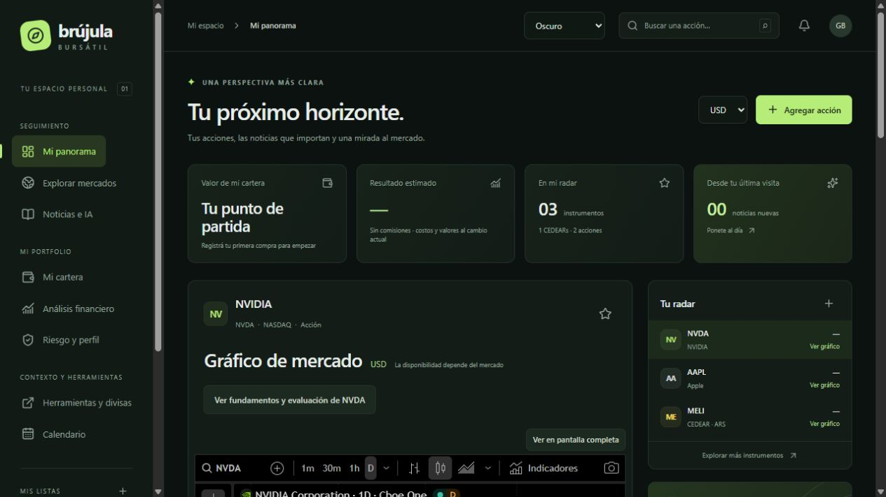

# Brújula Bursátil

**Tu espacio para seguir instrumentos, leer noticias y registrar una cartera multimoneda en el navegador.**

[](https://github.com/GermanBartoli/brujula-bursatil)
[](https://github.com/GermanBartoli/brujula-bursatil/actions/workflows/deploy.yml)

[Abrir en Cloudflare](https://brujula-bursatil.pages.dev/) · [Empezar](#primeros-pasos) · [Mapa del repositorio](#mapa-del-repositorio) · [Autoría](#autoría-de-esta-documentación)



*Captura de la página publicada, tomada el 9 de noviembre de 2026. Conservada sin redimensionar ni recomprimir.*

## Primeros pasos

1. Abrí Explorar mercados y agregá instrumentos a tus listas.
2. En Mi cartera registrá cantidad, costo y moneda de compra; revisá qué posiciones tienen cotización disponible.
3. Usá Preferencias y respaldo para exportar tus datos. Noticias, fuentes y análisis tienen los límites detallados más abajo.

## Referencia y detalles

Un panel personal para seguir acciones internacionales y CEDEARs, leer sus noticias y registrar una cartera en el navegador.

- Sitio: https://brujula-bursatil.pages.dev
- Repositorio: https://github.com/GermanBartoli/brujula-bursatil
- Autor: German Bartoli. Colaboración: Codex.

## Qué incluye

- Panel adaptable a escritorio y celular, en español.
- Favoritas, listas personalizadas y posiciones con cantidad y costo promedio.
- Búsqueda internacional paginada con Marketaux, catálogo inicial y CEDEARs disponibles en Data912.
- Gráficos interactivos, perfil de empresa y calendario económico de TradingView; enlace a próximos balances.
- Noticias directas o contexto sectorial, agrupación de duplicados y novedades desde la última visita.
- Análisis bajo demanda del título y extracto con Cloudflare Workers AI.
- Cartera multimoneda con moneda de compra independiente, conversión cruzada vía USD y ARS por CCL.
- Países, bolsas, región asiática y ETFs; identidades distintas por cotización.
- Fundamentos y técnicos de TradingView, evaluación manual de 21 indicadores, riesgo y perfil con IA.
- Inflación anual observada, escenarios de tasas e inflación y accesos a herramientas por categoría.
- Respaldo JSON con exportación, validación e importación confirmada.
- Publicación automática en Cloudflare Pages después de verificar cada push a `main`.

## Tecnología

React, TypeScript, Vite, Tailwind CSS, Lucide y una API en el runtime de Workers mediante el modo avanzado de Pages. No requiere cuentas de usuario ni base de datos de carteras.

## Desarrollo

Requiere Node.js 24 o posterior.

```powershell
pnpm install --frozen-lockfile
pnpm run build
Copy-Item .dev.vars.example .dev.vars
```

Completá `.dev.vars` localmente con las claves de Marketaux. Está excluido de Git. Luego iniciá la API y, en otra terminal, el frontend:

```powershell
pnpm run preview
```

```powershell
pnpm run dev
```

La aplicación de desarrollo se abre en `http://127.0.0.1:5173`; Vite redirige `/api` al servidor Pages de `127.0.0.1:8787`. Workers AI requiere conexión a Cloudflare y su binding. El build genera el cliente y `dist/_worker.js`; `_routes.json` dirige únicamente `/api/*` al Worker.

## Secretos y despliegue

Los secretos de GitHub Actions son `CLOUDFLARE_API_TOKEN`, `CLOUDFLARE_ACCOUNT_ID`, `MARKETAUX_API_KEY`, `MARKETAUX_API_KEY_BACKUP` y `MARKETAUX_API_KEY_THIRD`. Nunca se incluyen en el frontend ni en archivos versionados. Las claves de Marketaux también deben estar configuradas como secretos de producción del proyecto Pages. El flujo sincroniza los secretos de Marketaux antes de publicar. No ejecuta despliegues desde pull requests.

Se reutiliza el proyecto `brujula-bursatil`, con rama de producción `main` y binding de Workers AI `AI`. Se eligió Pages porque el token de la cuenta permite gestionar Pages, pero no el despliegue independiente de Workers. No hay una segunda integración Git de Cloudflare: GitHub Actions es la única automatización.

Para desplegar manualmente con el token y cuenta ya configurados en el entorno:

```powershell
pnpm run deploy
```

## Verificaciones

```powershell
pnpm test
pnpm run build
pnpm exec playwright install chromium
pnpm run test:e2e
```

Las pruebas unitarias cubren conversión, cotización del CEDEAR frente a su subyacente, datos faltantes, importación inválida, respaldo de Marketaux por cuota, validación de IA y rechazo de solicitudes incorrectas. Las pruebas de navegador usan respuestas simuladas para no consumir cuotas: comprueban cartera persistente, exportación, navegación móvil, teclado y ausencia de desborde. La disponibilidad real de proveedores se verifica por separado al publicar.

## Datos y límites

| Fuente | Uso | Limitaciones |
| --- | --- | --- |
| [Marketaux](https://www.marketaux.com/documentation) | Entidades, noticias y sentimiento | La búsqueda abarca su cobertura, no garantiza todas las acciones del mundo. Se solicitan hasta tres noticias por empresa y página, con hasta quince empresas por tanda. «Ver más noticias» acumula páginas y las tandas permiten recorrer listas más grandes. |
| [TradingView](https://www.tradingview.com/widget-docs/) | Gráficos y calendario | Algunos instrumentos o bolsas no están disponibles en widgets; pueden existir demoras. |
| [Data912](https://data912.apidocs.ar/) | Cotizaciones de EE. UU., acciones argentinas y CEDEARs | Servicio educativo, no garantiza datos en tiempo real. Sin cobertura, se muestra el estado correspondiente. |
| [DolarAPI](https://dolarapi.com/) | Referencia CCL | Tipo de cambio indicativo al momento de la consulta. |
| [Cloudflare Workers AI](https://developers.cloudflare.com/workers-ai/) | Resumen y posible impacto | Analiza título y extracto, no el artículo completo. Puede cometer errores. |

El catálogo argentino incluye las acciones locales en pesos identificadas en el [listado de TradingView](https://es.tradingview.com/markets/stocks-argentina/market-movers-all-stocks/) al 2 de noviembre de 2026, incluida TGNO4 (Transportadora de Gas del Norte). Se excluyen CEDEARs, fondos, especies en dólares y duplicados de liquidación inmediata. Los precios se actualizan desde Data912; un instrumento sin cotización se mantiene visible sin inventar un precio. Incluye también especies sin operaciones recientes identificadas por BYMA/IAMC. Las nuevas altas requieren actualizar el catálogo.

El calendario integrado es económico; los balances se consultan mediante enlace a TradingView. No se inventan fechas de balances ni precios. Los CEDEARs se vinculan con las correspondencias de Data912 y una selección inicial verificada. Se incluyen únicamente las especies en pesos identificadas; las variantes D/C en dólares no se confunden con ARS. El símbolo de origen puede corregirse al editar una posición. No se aplican ratios de conversión de títulos.

Las posiciones se valoran con el precio del instrumento y su moneda. El costo y el valor actual se convierten con tipos de cambio actuales (ARS vía CCL): el resultado no representa la ganancia histórica por tipo de cambio. Las posiciones sin precio o sin conversión quedan excluidas del total y se contabilizan como faltantes. No se calculan comisiones, dividendos, impuestos ni ajustes corporativos.

Las noticias permiten elegir inglés (predeterminado), español o ambos idiomas y filtrar entidades por país, región asiática o todo el mundo. «Todo el mercado» consulta cobertura general sin limitarla a la cartera. El país corresponde al mercado de la entidad, no al origen del medio. «Más noticias de [acción]» abre su listado individual; los filtros de idioma y país forman parte de la clave de caché.

## Privacidad y protección de cuotas

La cartera, los costos y cantidades se guardan en `localStorage`. El análisis de perfil, solicitado por el usuario, envía símbolos, bolsas, sectores, divisas, etiquetas de riesgo y pesos porcentuales a Workers AI; no envía cantidades ni importes. Los símbolos consultados sí se envían a la API. Los widgets conectan el navegador con TradingView. Los respaldos contienen datos personales de cartera y no se sincronizan automáticamente entre dispositivos.

La API utiliza caché compartida por centro de datos: cinco minutos para cotizaciones, treinta minutos para noticias y un día para búsquedas y análisis. Se prioriza la clave de respaldo, luego la tercera y finalmente la original ante cuota agotada o límite de consultas; no se rotan credenciales inválidas. La caché de noticias es por empresa y página, reutilizable entre listas y selección individual. El navegador también conserva los resultados durante treinta minutos en la sesión; las consultas simultáneas idénticas se agrupan. Los fallos parciales se indican y no se guardan en esa caché. Las claves y errores privados del proveedor no se devuelven al navegador.

El análisis de noticias acepta únicamente identificadores de noticias previamente consultadas y almacenadas; no permite enviar prompts arbitrarios ni descargar URLs indicadas por el cliente. Tiene límites por IP e instancia. En Pages estos contadores son aproximados y no constituyen una cuota global distribuida. Antes de abrir el servicio a un público amplio, agregar control de acceso, límites globales durables y monitoreo del consumo.

## Próximas ampliaciones

- Proveedor de cotizaciones globales con cobertura y licencias verificadas.
- Calendario de balances por empresa y alertas con fechas reales.
- Catálogo oficial completo de CEDEARs, ratios y eventos corporativos.
- Sincronización opcional entre dispositivos, manteniendo el modo local.
- Rendimiento histórico con tipo de cambio de cada operación.

## Licencia

Código bajo licencia MIT. Las marcas, widgets y datos de terceros conservan sus condiciones de uso.

## Apariencia y filtros personales

El selector de la barra superior permite elegir Oscuro, Oscuro suave y Claro; el gráfico y el calendario también acompañan el modo claro. Las noticias se presentan en tarjetas separadas.

«Crear filtro» permite nombrar una selección de acciones, guardarla y volver a elegirla en «Noticias de». El filtro puede editarse o eliminarse, y conserva sus instrumentos aunque se quiten del seguimiento. Temas y filtros se guardan en `brujula:preferencias:v1` dentro de `localStorage`; son preferencias del navegador y no forman parte del respaldo de cartera. Se reutiliza la caché existente por empresa, página, idioma y mercado.

Los modales se cierran con la cruz, Escape o un clic que comience y termine fuera; arrastrar una selección de texto hacia afuera no los cierra.

## Mercados, multimoneda y análisis · v0.4.0

### Corrección del buscador · v0.4.1

El buscador conserva la bolsa al consultar. NVIDIA alemana se encuentra como `ETR:NVD`, `XETR:NVD`, `XETRA:NVD`, `NVD:ETR` o `NVD.DE` para Xetra, y `FRA:NVD`, `FWB:NVD`, `XFRA:NVD` o `NVD.F` para Frankfurt, ambas en EUR. `NASDAQ:NVDA` sigue siendo otra cotización, en USD. Se aceptan también fórmulas GOOGLEFINANCE con estos códigos.

También reconoce prefijos de Ámsterdam, París, Londres, Nasdaq, NYSE, Hong Kong y Tokio y sus sufijos admitidos. Las búsquedas explícitas fuera del catálogo verifican símbolo, tipo y moneda con la fuente de precios; no sustituyen silenciosamente la bolsa por EE. UU. Si el proveedor no reconoce el código, se informa el error. Las posiciones existentes no se migran automáticamente.

La navegación agrupa Seguimiento, Mi portfolio y Contexto y herramientas. El buscador reconoce `AMS:VHYL`, `IBKR` y las fórmulas `=GOOGLEFINANCE("AMS:VHYL"; "price")` / `=GOOGLEFINANCE("IBKR"; "price")` como búsquedas; no ejecuta fórmulas. Ámsterdam y Londres conservan posiciones independientes para VHYL. Las noticias utilizan símbolos con sufijo de mercado para distinguir estas cotizaciones. Los filtros de país representan la plaza de cotización, no toda la exposición económica.

### Monedas y precios

- USD, ARS, EUR, GBP, CNY, HKD, JPY, CHF, CAD, AUD, BRL e INR como moneda final y de compra. La moneda de cotización se confirma al registrar; nunca se transforma automáticamente la divisa de una bolsa por la nacionalidad del emisor.
- [Frankfurter](https://frankfurter.dev/) aporta unidades por USD y fecha de referencia. Los cruces usan `importe / tasaOrigen × tasaDestino`. ARS utiliza exclusivamente CCL de DolarAPI; si falta, no se sustituye por un cambio oficial.
- Yahoo Finance aporta precios indicativos de las plazas admitidas mediante el endpoint público de gráficos. Es una integración sin garantía de disponibilidad ni cobertura contractual; no es una API oficial contratada. Se valida símbolo, moneda y fecha, y se normalizan GBp/GBX a GBP. El precio solo se usa cuando coincide con la moneda registrada. Data912 mantiene la cobertura anterior.
- Los precios se consultan para el instrumento seleccionado y las posiciones, en tandas de hasta 20 y con caché de cinco minutos. La lista completa de exploración no descarga precios de todos sus instrumentos. La API puede fallar o limitar consultas: se informan faltantes y se permite registrar un precio manual fechado que tiene prioridad hasta borrarlo.
- La moneda de compra es independiente de la de cotización. Por ejemplo, 2 títulos a 80 EUR equivalen a 200 USD si EUR/USD es 1,25; un costo de 90 USD por título da 20 USD de diferencia. Los dos lados se expresan en la moneda final antes de sumarse.
- Los respaldos v1 anteriores siguen siendo válidos. Los campos opcionales de riesgo, moneda de compra y precio manual se validan al importar. Los totales incompletos se identifican como parciales; una cartera totalmente sin precio no se muestra como cero.

### Evaluación financiera

Al elegir un ticker, la sección solicita [fundamentos de TradingView](https://www.tradingview.com/widget-docs/widgets/symbol-details/fundamental-data/) y señales técnicas para su bolsa. La cobertura depende del proveedor. La ficha de 21 indicadores reproduce la estructura de la tabla del usuario, pero sus valores son manuales: no se extraen del iframe ni se inventan cuando faltan. Los umbrales son referencias orientativas, no recomendaciones. NIM y cobertura de intereses son métricas independientes; NIM no tiene un mínimo universal del 10%. En ETFs se advierte que hay que revisar composición, TER y estructura.

Cada evaluación se guarda en `brujula:evaluacion:v1:<bolsa:ticker>` con fuente, período, notas y fecha. Tiene exportación JSON propia; no forma parte del respaldo de cartera ni se importa con ese respaldo.

### Riesgo, IA y macroeconomía

El riesgo bajo, medio o alto lo asigna el usuario. Los porcentajes usan el valor convertido, incluyendo una categoría sin clasificar. Se puede incluir al costo una posición sin cotización, identificada como estimación; las posiciones sin una conversión válida permanecen excluidas. No representan probabilidades de pérdida. La IA analiza hasta 100 posiciones valuadas, concentración y posibles solapamientos sin afirmar conocer la tolerancia personal del inversor ni la composición interna de fondos. El servidor valida pesos y campos, rechaza orígenes ajenos y limita consultas.

El calendario incorpora una serie anual del [Banco Mundial / FMI](https://data.worldbank.org/indicator/FP.CPI.TOTL.ZG), con hasta ocho observaciones disponibles y variación en puntos porcentuales. No sustituye el último IPC mensual. EUR corresponde a la zona euro. Las reuniones y resultados del widget no se extraen automáticamente: se puede anotar el evento, elegir posiciones por moneda o toda la cartera e introducir tasas y sensibilidades.

El escenario calcula `Δprecio % = Δtasa en puntos porcentuales × sensibilidadTasa + Δinflación en puntos porcentuales × sensibilidadInflación`. Las sensibilidades las introduce el usuario, no son coeficientes inferidos ni predicciones. Rechaza una pérdida superior al 100% y mantiene las divisas constantes. La explicación de canales se basa en los [mecanismos de transmisión de la Fed](https://www.federalreserve.gov/monetarypolicy/monetary-policy-what-are-its-goals-how-does-it-work.htm).

### Verificaciones adicionales

Las pruebas cubren cruces de divisas, costos en otra moneda, GBp, identidad por mercado, respaldos anteriores, exclusión de datos faltantes, riesgo por valor, validación del perfil IA y simulación macroeconómica. Las pruebas de navegador recorren ETFs y noticias por región, la fórmula de VHYL, compra en USD con total en GBP, perfil, fundamentos separados por ticker y ausencia de desborde en móvil.

### Cotizaciones, noticias y fuentes (v0.5.0)

- MEUD.PA (París, EUR) e IB01 (Londres, USD) forman parte del catálogo. Los identificadores antiguos `OTROS:MEUD.PA` y `OTROS:IB01.L` recuperan precios sin reescribir el respaldo ni sustituir la moneda. Los gráficos reconocen los alias anteriores.
- Riesgo permite incluir al costo las posiciones sin cotización, con etiqueta «estimado al costo» y opción de excluirlas. Este recurso no altera el valor de mercado ni las ganancias de la cartera; una conversión faltante sigue sin inventarse.
- Las menciones directas requieren entidad identificada y nombre o ticker explícito en título/extracto. Las noticias sobre NVIDIA alemana usan la entidad de la empresa estadounidense. La cobertura puede reducirse si el extracto no contiene la mención.
- Los ETF seleccionados usan contexto configurable por sector o clase de activo. IB01 consulta bonos del Tesoro y tasas; MEUD, renta variable europea; VHYL, contexto diversificado. No se afirma conocer participaciones ni ponderaciones actuales. Hay sectores de salud, industria, materiales, servicios e inmobiliario, además de los existentes.
- NVIDIA e Interactive Brokers consultan directamente sus publicaciones oficiales (RSS y página de comunicados, respectivamente), con fecha y enlaces originales. Otros emisores configurados ofrecen el filtro por dominio de Marketaux y acceso a documentación oficial: la indexación no garantiza cubrir la última publicación. Los comunicados directos conservan su idioma original y no aplican el filtro regional.
- Se pueden guardar hasta ocho dominios de prensa en este navegador. Filtran fuentes indexadas por Marketaux; no ejecutan solicitudes a URLs arbitrarias. Se guardan en `brujula:fuentes:v1`, fuera del respaldo de cartera, y pueden restablecerse.
- El resumen con IA usa hasta doce noticias recuperadas desde la caché del servidor, con referencias numeradas. Distingue hechos de posibles efectos sobre tasas, inflación, regulación y sectores, sin inventar composición ni predecir precios.

Fuentes técnicas: [Marketaux](https://www.marketaux.com/documentation), [RSS oficial de NVIDIA](https://investor.nvidia.com/investor-resources/rss/default.aspx), [comunicados de IBKR](https://investors.interactivebrokers.com/en/general/about/press-releases-nav.php), [fondo MEUD](https://www.amundietf.de/de/professionell/products/equity/amundi-core-stoxx-europe-600-ucits-etf-acc/lu0908500753), [ficha IB01](https://www.ishares.com/uk/individual/en/literature/fact-sheet/ib01-ishares-treasury-bond-0-1yr-ucits-etf-fund-fact-sheet-en-gb.pdf).

### Disponibilidad alternativa de noticias (v0.5.1)

Cuando Marketaux falla o no devuelve resultados verificables, se consulta Google News RSS con el mismo contexto sectorial o nombres de empresa. Se mantienen las menciones visibles y la selección de dominios. El proveedor alternativo se identifica en pantalla: solo aporta titulares, no el contenido completo, y su edición regional no garantiza el país de las empresas. La IA recibe explícitamente ese límite y conserva enlaces a las fuentes.

La búsqueda de IB01 exige contexto visible del Tesoro estadounidense o la Reserva Federal; no acepta una referencia genérica a una tesorería. Este filtro se aplica tanto al proveedor principal como al alternativo.

## Guardado y límite de instrumentos

La versión 0.5.3 coordina los cambios entre pestañas mediante Web Locks y actualiza la vista al recibir cambios de almacenamiento o recuperar el foco. Cada operación lee la versión más reciente antes de guardar. El límite de 500 instrumentos se valida antes de escribir: si una operación lo supera, se rechaza completa y se muestra el motivo. Los datos guardados que no pueden interpretarse no se reemplazan silenciosamente.


## Mapa del repositorio

- [package.json](<package.json>)
- [LICENSE](<LICENSE>)
- [index.html](<index.html>)

## Autoría de esta documentación

Repositorio mantenido por [Germán Bartoli](https://github.com/GermanBartoli). Guía revisada y actualizada con **Codex**, coautor de esta actualización documental. Los autores, colaboradores, licencias y recursos de terceros conservan sus créditos originales.

Los commits de esta revisión incluyen `Co-authored-by: Codex <noreply@openai.com>`; esta atribución no modifica la autoría del historial anterior.

<!-- firma-german-bartoli -->
<p align="center">
  <a href="https://germanbartoli.pages.dev/">
    <br />
    Hecho por Germán Bartoli · Ver portfolio
  </a>
</p>
